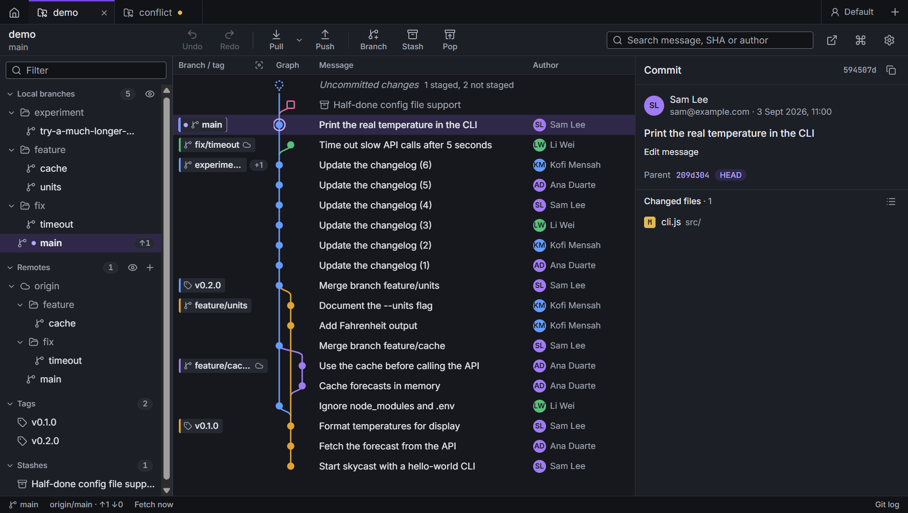
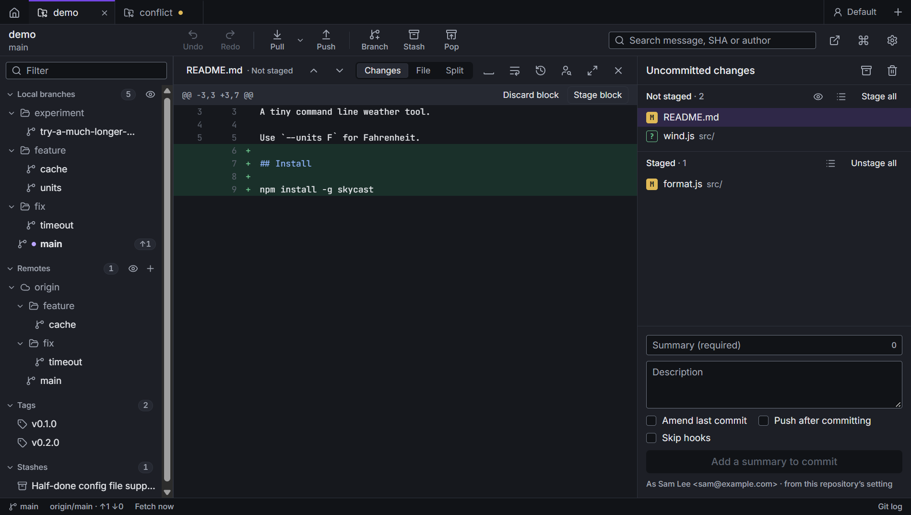
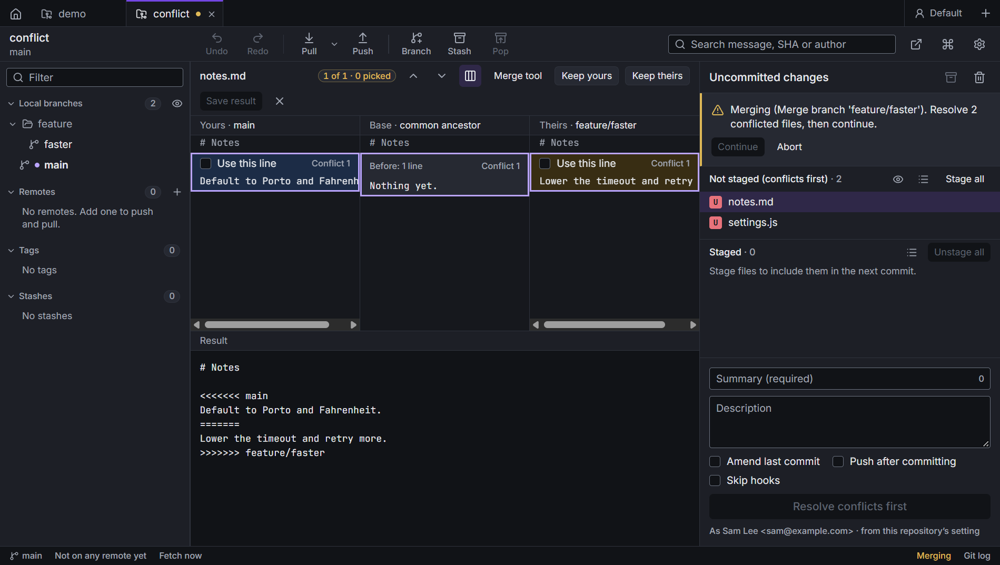

<p align="center">
  <picture>
    <source media="(prefers-color-scheme: dark)" srcset="docs/images/logo-dark.png">
    
  </picture>
</p>

<p align="center">A desktop Git client with a commit graph, built on the git you already have.</p>



Caboose runs **your installed git**, with your config, your SSH setup, your credential manager and your hooks.
Every command it runs is listed in the Git log view, ready to copy. There's no account and no subscription. It
works offline, and it doesn't phone home.

## What it does

### Repositories and tabs

- Open a folder, clone a URL or start a new repository. A clone can be shallow (recent history only) or check out
  only some folders (sparse checkout). The folder picker opens where you last picked a folder.
- Each repository opens in its own tab. The Repositories tab lists recent ones, with favourites and groups.
- Open the repository in your editor, terminal or file manager.
- Changes made outside the app (a commit, a new branch, a checkout in the terminal) show up when you come back to it.

### Commit graph

- Branches, tags, stashes and remotes, laid out in lanes, with the uncommitted changes on top.
- Focus on one branch, show only one commit's history, hide the branches and tags you don't care about, pin a
  branch to the left.
- Search the whole history by message, SHA or author.
- Columns can be shown, hidden, reordered and resized, Graph and Branch / tag included. A wide graph scrolls
  sideways. The widths are saved per repository.
- Move with J / K, or Ctrl+Home / Ctrl+End.

### Staging and diffs

- Changed files as a flat list or a folder tree, in Not staged and Staged.
- Stage or unstage files, blocks or single lines, with the mouse or the keyboard. Discard them too, with undo.
- Inline or side by side, with whitespace hidden or not, long lines wrapped or not, your code size and tab width.
- Find in the open file (Ctrl+F), with every match highlighted.
- Binary files, Git LFS files and submodule pointers each get a diff that says what changed.
- Ignore files from their menu, one or several at once: the file, its extension or its folder.
- After a commit leaves nothing to commit, you're back on the commit list.

### Commits

- Summary and description, with your commit message template. Amend the last commit, sign commits, push after
  committing.
- Edit any commit's message, squash several into one (every message kept, ready to edit), move a commit up or down,
  revert, cherry-pick one or several, reset (soft, mixed or hard).
- Git hooks run when history is rewritten, unless you tick Skip hooks.

### Branches and tags

- Create a branch from any commit, rename, check out, delete. Pick several branches or tags and push or delete
  them at once, on the remote too. The dialog says that undo only brings back the local side.
- Merge or rebase by dragging one branch onto another.
- Pull or fast-forward a branch without switching to it. Double-click a remote branch to fast-forward the local one
  and check it out, or reset it when it can't fast-forward.
- Reset a local branch to a remote branch from its menu.
- "/" in branch names becomes folders. Collapse or expand every folder or every section at once. Filter the list
  (Ctrl+Alt+F).
- Tags: create, delete, push to one remote or to all of them.

### Interactive rebase

- Keep, reword, squash, fixup, drop or reorder, for a whole branch or only the commits you pick.

### Conflicts

- A three-way merge tool: yours, the common ancestor and theirs side by side. Pick lines, edit the result and save.
- A paused merge, rebase or cherry-pick says what's left, with Continue and Abort.
- Open a conflict in your own merge tool instead, if you prefer.

### Sync

- Fetch, pull (merge, fast-forward only, fast-forward when possible, or rebase), push, force push with lease.
- With several remotes, push the current branch or a tag to whichever one you pick.
- Set upstreams, add and remove remotes.
- Fetch in the background, every 1 to 60 minutes, without ever asking for a password.
- When your changes are in a pull's way, stash or discard them from the same dialog.
- Long operations show git's own progress: the percentage and the count, for example 45% (58234/129384).

### Stashes

- Stash your changes (new files too, if you want), apply, pop, rename, delete one or several.

### Bisect

- Find the commit that broke something: mark commits good, bad or skipped by hand, or let a test command decide.

### Submodules

- List them, set them up (shallow, nested ones too), and pick a mode for each: Follow keeps it at the commit the
  branch expects, Manual moves it only when you ask, and Working in it never moves it while it has unpushed work.
- A pointer change says what it means: the commits it moves by, or a warning when it moves back.
- Checks before pushing, and can push submodules first.

### Worktrees

- List, open, create (also from a branch's menu), remove, lock and unlock them, and forget the ones whose folders
  are gone.

### Git LFS

- A badge on LFS files, and a diff that says how the file changed.
- Track or stop tracking a file, or all files with its extension, from the file's menu. Says when LFS isn't
  installed or set up, and sets it up for you.

### Undo

- Most actions can be undone (Ctrl+Z) and redone (Ctrl+Y), even after a restart. Caboose refuses safely if the
  repository changed in between.

### History and blame

- The history of a file, blame for the current version or at any commit, and back and forth between the two.

### Profiles

- Separate tabs, settings and identity for work and personal projects: name, email, signing key and the SSH key
  used to fetch and push. Caboose can create an SSH key for you and copy its public half.
- Repository settings can override your global ones (signing, for example).

### Everything else

- A Git activity log with every command Caboose ran and its output, ready to copy.
- A command palette (Ctrl+P) and keyboard shortcuts for most things (Ctrl+/ lists them).
- Light and dark themes, or follow the system.
- Side panels collapse to thin rails (Ctrl+J, Ctrl+K) and remember it.
- Your own editor, terminal, diff tool and merge tool.
- Falls back to software rendering when graphics acceleration doesn't work.





## Requirements

- **Git 2.30 or newer** on your `PATH` (tested with 2.47).
- **Node.js 24** to build it (`.nvmrc` has the version; `nvm use` picks it up).
- Windows, macOS or Linux. Day-to-day development happens on Windows; please report anything that breaks elsewhere.

## Run it from source

```bash
git clone https://github.com/aautotte/caboose.git
cd caboose
nvm use          # or install Node 24 another way
npm ci
npm run dev
```

## Build your own launcher

No prebuilt binaries are published. You build your own copy:

```bash
npm ci
npm run dist
```

That builds for the system you're on, into `dist/`:

| system | what you get |
| --- | --- |
| Windows | `Caboose-Setup-<version>.exe` (installer: Start menu entry, uninstaller, no admin rights needed) and `Caboose-<version>-portable.exe` (one file, no install) |
| macOS | a `.dmg` (build it on a Mac) |
| Linux | an `.AppImage` (build it on Linux) |

Your build isn't code-signed, so the first launch shows a warning:

- **Windows:** "Windows protected your PC". Click **More info**, then **Run anyway**.
- **macOS:** right-click the app, choose **Open**, then **Open** again.

Settings, profiles and the repository list live in your user data folder (for example `%APPDATA%\Caboose`). They
survive reinstalls, and a newer build picks them up. Git still has to be installed, since Caboose uses yours.

## Tests

```bash
npm run typecheck
npm run e2e         # builds, then runs the Playwright end-to-end suite against throwaway repositories
```

The end-to-end tests launch the real app against repositories they create under `.seed/`, with their own home
folder and git config, so they never touch yours. A full run takes about twenty minutes.

## Project layout

```
src/main/        Electron main process: git runner, repository operations, undo, IPC, settings (SQLite)
src/preload/     the bridge the window uses to call the main process
src/renderer/    the React app: screens, store, design primitives
src/shared/      types and the IPC contract shared by both sides
design/          design tokens (colour roles, type, spacing) for dark and light
scripts/         seed repositories, screenshots, token and icon generators, contrast check
tests/e2e/       Playwright end-to-end tests
resources/       the app icon (SVG masters and generated PNG / ICO)
```

## Troubleshooting

### `npm run dev` stops with "Error: Electron uninstall"

The `electron` package is installed, but its binary isn't. Electron downloads it in an install script that runs
during `npm ci`, and that script didn't run, usually because npm is set to skip install scripts
(`npm config get ignore-scripts` prints `true`), or because `npm ci` was stopped before it finished. Run the script
yourself:

```bash
node node_modules/electron/install.js
npm run dev
```

If it can't download (behind a proxy, or offline), set `ELECTRON_MIRROR` to a mirror you can reach and run it again.
With `ignore-scripts` on, you need that first line again after each `npm ci`.

## Contributing

Issues and pull requests are welcome. See [CONTRIBUTING.md](CONTRIBUTING.md). For security problems, see
[SECURITY.md](SECURITY.md) instead of opening a public issue.

## License

[MIT](LICENSE). Use it, change it, share it.
