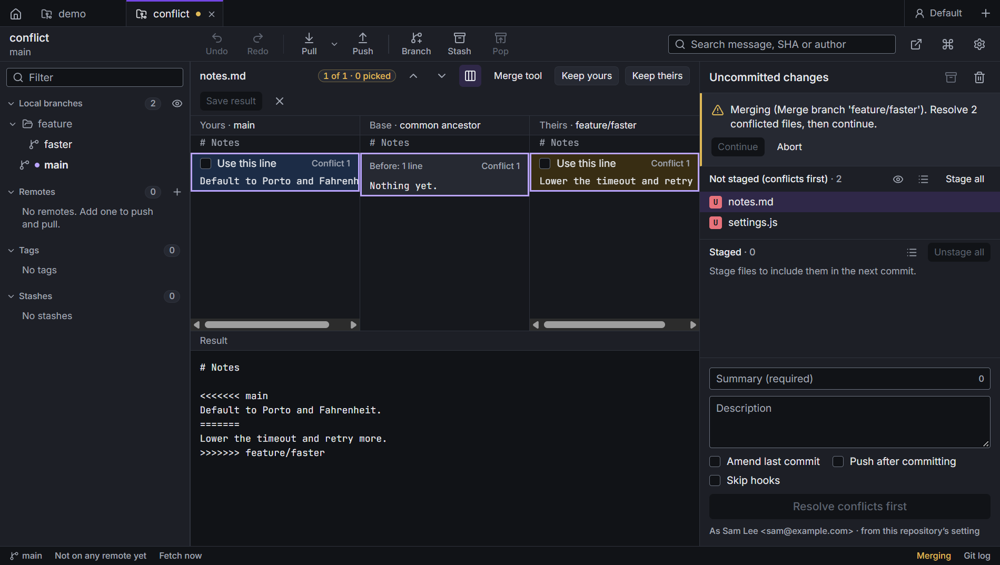

# Conflicts and the merge tool

A merge, rebase, cherry-pick, revert, pull or stash pop can stop when both sides changed the same lines. Caboose
then shows a banner over the uncommitted changes: what's paused, how many files are still conflicted, and the
buttons to finish.

| | |
| --- | --- |
| **Continue** | once every conflicted file is resolved and staged |
| **Skip this commit** | during a rebase: leave out the commit that conflicts and go on |
| **Abort** | put everything back as it was before the operation started |

A rebase also stops at a commit marked [Edit](rewriting-history.md#stop-to-edit-a-commit). There's nothing to
resolve: change the commit, then **Continue**.

Conflicted files are marked **U** in the file list. Click one to open it in the merge tool.

## Before you start

Before a merge, a rebase onto another branch, or a pull that merges or rebases, Caboose works out whether it would
conflict, with `git merge-tree`: nothing in your files changes. If it would, it says so first, and with which files:

- a merge: *Merging feature into main will conflict. Both sides changed the same lines in app.ts and README.md.*
- a rebase replays one commit at a time, so it says which commit it would stop at: *It would stop at “Raise the
  timeout” (commit 2 of 5)*.
- a pull works from the last fetch: anything newer on the remote is fetched first, and isn't in the forecast.

**Merge anyway** (or **Rebase anyway**, **Pull anyway**) goes ahead, and the conflicts are resolved as below.
**Cancel** leaves everything as it was. One that goes through cleanly doesn't ask.

## The merge tool

The top shows **yours** (the branch you're on) and **theirs** (what's coming in) side by side, with the **base**
(their common ancestor) in between when **Show the base** is on. The bottom is the **merged result**.

- For each conflict, pick the lines to use from either side: **Use this line** or **Use these lines**. Picks from
  both sides go in the order you pick them.
- **Previous conflict** and **Next conflict** jump between them.
- **Keep yours** or **Keep theirs** resolves the whole file one way.
- You can type in the merged result directly. **Rebuild from picks** drops your edits and starts again from the
  picks.
- **Save result** writes the file and stages it. It's enabled once no conflict is left open.

The words each side changed are highlighted: against the base when it's known, against the other side otherwise.
Above each side's lines, **Changed in** names the commits on that side that changed them since the two sides split,
newest first, with who made the last one and when: often what decides which side is right. Click one to see it in
the details panel; **Uncommitted changes** brings back the conflict banner.

### Suggestions

When the answer is clear from the two sides and what they started from, a conflict says what to keep, and why:

| Suggested | When |
| --- | --- |
| **keep it once** | both sides made the same change |
| **keep yours** or **keep theirs** | the other side left these lines as they were, or only changed their spacing; or both made the same change apart from spacing |
| **keep both, sorted** | both sides added lines to a sorted list, such as imports: they go in, in order, a line both added once |
| **keep both** | both sides added lines at the same place (yours first), or changed different lines next to each other, which git counts as a conflict too |

**Use suggestion** puts it in the result, and **Use *n* suggestions** in the header takes them all. Nothing is taken
until you ask, and nothing is saved until **Save result**. Ticking a side by hand replaces a suggestion. A conflict
where both sides changed the same lines differently gets no suggestion: that one takes a person.

Some conflicts aren't about lines:

- **Deleted on one side, changed on the other**: **Keep the edited file** or **Delete it**.
- **Binary files**: **Keep yours** or **Keep theirs**.

## Your own merge tool

**Merge tool** in the merge tool's header, or **Open in merge tool** in a conflicted file's menu, runs the tool set
in git's `merge.tool` (for example meld, kdiff3 or Beyond Compare). Set it in
[Settings](settings.md#external-tools).

## Undo

A merge, rebase or pull that stopped on conflicts is recorded once it finishes. **Undo** then puts the branch back
where it was before it started. See [Undo](undo.md).
