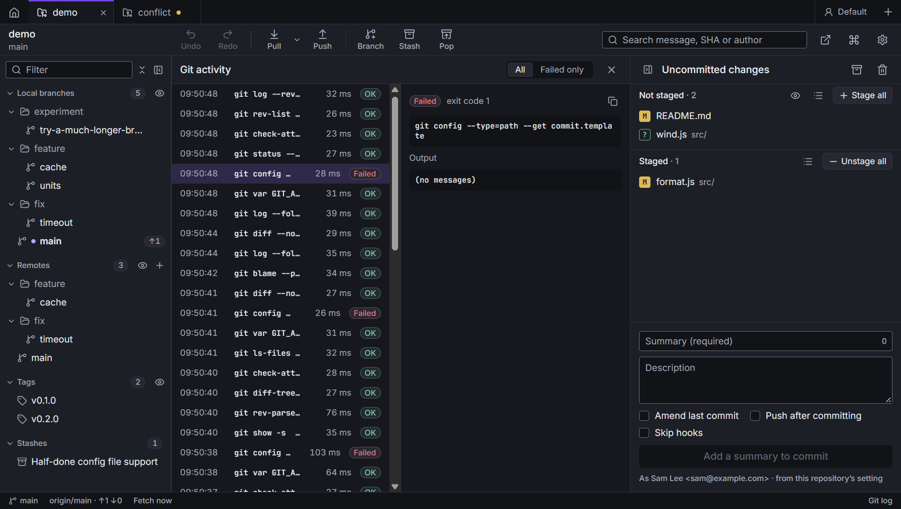
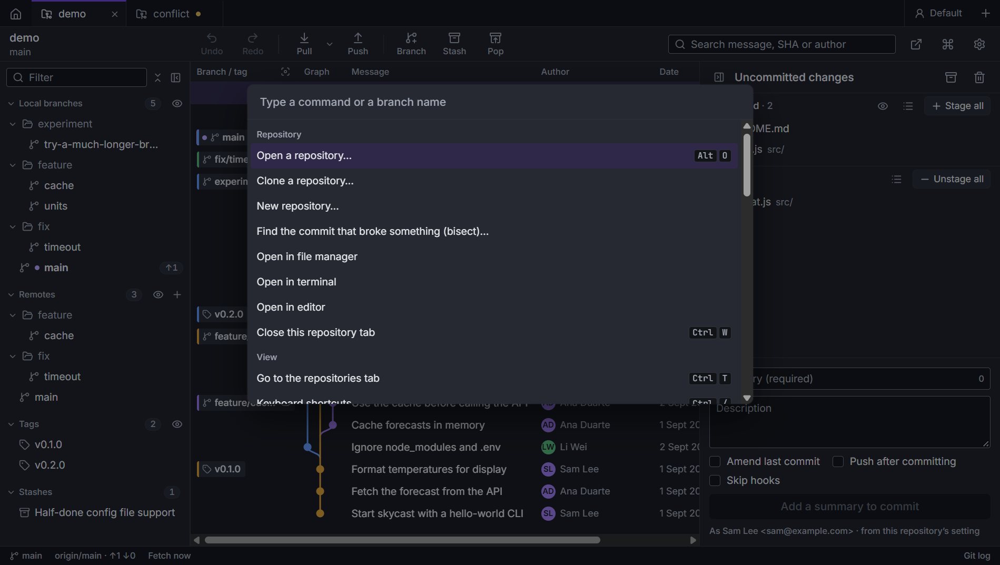

# Everything else

## Git activity log

**Git log** at the right of the status bar, or **Git activity log** in the command palette, lists every git command
Caboose ran in this repository: when, how long it took, and whether it worked. **Failed only** narrows the list to
the ones that didn't.

Click a command to see it in full with its output. The copy button copies both, ready to run in a terminal or paste
into a bug report.

Some failures are normal: Caboose asks git questions whose answer is sometimes "no", such as whether a setting
exists.

## Command palette

**Ctrl+P**, or the ⌘ button in the toolbar. Type to find a command: pull, push, fetch, stage, stash, new branch,
new worktree, bisect, open in editor, switch theme, settings and more. It also lists the branches, to check one
out or merge it, and offers blame and file history when a file is open.

## Panels

- Drag the edges between the branches panel, the graph and the details panel to resize them.
- **Ctrl+J** collapses the branches panel to a thin rail, **Ctrl+K** the details panel. Click the rail to bring it
  back. Collapsed panels stay collapsed in every repository, and after a restart.
- **Use the full width**, in a diff's header, hides both panels while you read the diff.

## Themes

Light, dark, or the same as your computer: **Theme** in [Settings](settings.md#general), or **Switch light / dark
theme** in the command palette.

## Notifications

Results show in the corner for a few seconds: what was done, or what went wrong and why. Some have a button for
the next step, such as **Fetch now** after a force push stopped, or **Show details**, which opens the Git activity log with the full error.

## Graphics

Caboose draws with your graphics card. If it crashed with it on, it starts the next time without it and says so.
You can switch it in [Settings](settings.md#general).
