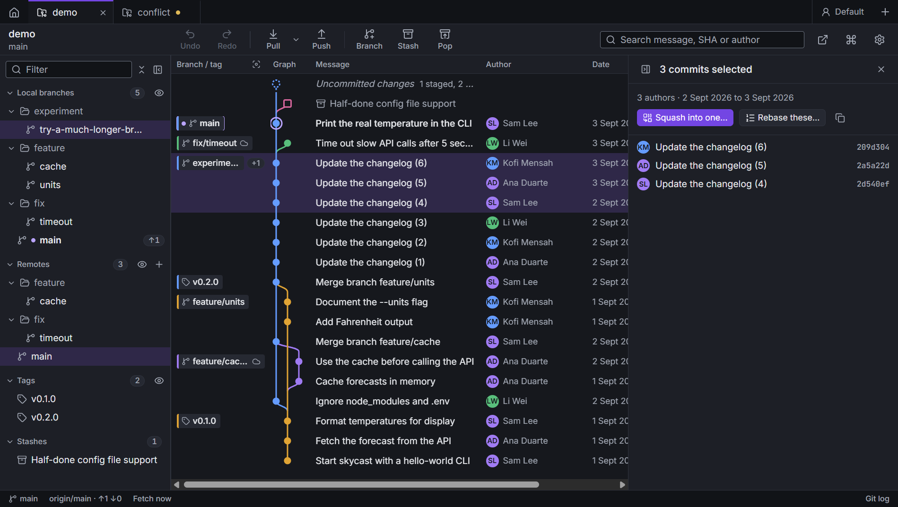

# The commit graph

Every commit is a row, newest at the top. Each line of development gets its own lane and colour. The first row,
**Uncommitted changes**, is your working copy; it's there when you have changes. Stashes appear as rows too, next
to the commit they were made on.

Labels in the **Branch / tag** column show local branches, remote branches and tags. A local branch and its
remote branch on the same commit share one label, with a cloud icon. `+1` means more labels on that commit; hover
to see them, click for their menus.

## Selecting

- Click a row to see the commit in the details panel: its message, author, files and the diff of each file.
- **J / K** or the arrow keys move down and up. **Ctrl+Home / Ctrl+End** go to the first and last commit.
- **Ctrl+click** adds or removes commits; **Shift+click** picks a range. With several commits picked, the details
  panel offers **Squash into one…**, **Rebase these…**, cherry-pick and copying their SHAs.
- **Esc** clears the pick.

## Seeing less

- **Focus on this branch**: the target icon in the Branch / tag header, or **Focus on this branch (or show all)**
  in the command palette. The graph shows only the checked-out branch, the branch it tracks and main.
- **Show only this (and HEAD)**: from a branch's menu in the branches panel. **Stop showing only this** brings
  the rest back.
- **Hide from the graph**: from a branch's or tag's menu, or press **H** on it in the branches panel. The eye on
  a section header hides or shows the whole section. Hidden branches stay listed in the panel, with their eye
  showing, and **Show all branches in the graph** (command palette) brings them all back.
- **Pin to the left of the graph**: keeps a branch, usually main, in the leftmost lane.

The branches panel has a **Filter** box (Ctrl+Alt+F) that narrows branches, tags and stashes as you type.

## Searching

The search box in the toolbar (Ctrl+F when no file is open) searches the whole history by message, SHA or author,
not only what's loaded.

## Columns

Right-click the column headers to show or hide columns, move them left or right, or **Reset columns**.

- Drag the right edge of **Graph** to resize it; double-click it to fit the lanes. When the lanes don't fit, the
  graph scrolls sideways.
- Drag the right edge of **Branch / tag** to resize it; double-click it for the default width.

Widths are saved per repository.

## Commit menu

Right-click a commit:

| | |
| --- | --- |
| Create branch here… (Ctrl+B) | a new branch at this commit |
| New worktree here… | see [Worktrees](worktrees.md) |
| Create tag here… | with a message, it's an annotated tag |
| Check out this commit (detached) | |
| Cherry-pick onto *branch* | |
| Pick several commits up to here… | choose which ones to cherry-pick |
| Rewrite *branch* after this commit… | [interactive rebase](rewriting-history.md#interactive-rebase) |
| Reset *branch* to this commit… | [soft, mixed or hard](rewriting-history.md#reset) |
| Edit message…, Move commit up / down | see [Rewriting history](rewriting-history.md) |
| Bisect: this commit is bad… / good… | see [Bisect](bisect.md) |
| Revert this commit | |
| Copy commit SHA | |

Right-click a branch or tag label for the same menu as in the branches panel. See
[Branches, tags and stashes](branches-tags-stashes.md).

## Drag to merge or rebase

Drag a branch label onto another one in the graph. The menu that opens offers:

- **Merge** *source* **into** *target*;
- **Rebase** *source* **onto** *target*, or **step by step…** to open the [interactive rebase](rewriting-history.md#interactive-rebase);
- **Push** *source* **to** *remote*, when you drop a local branch on a remote branch.
