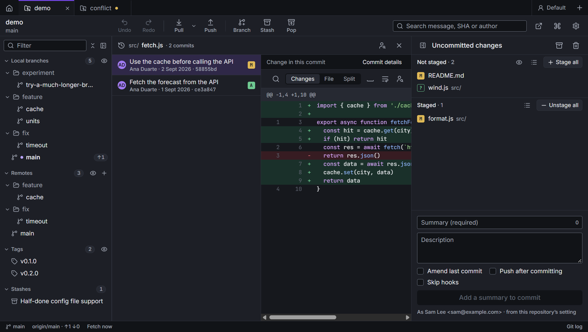
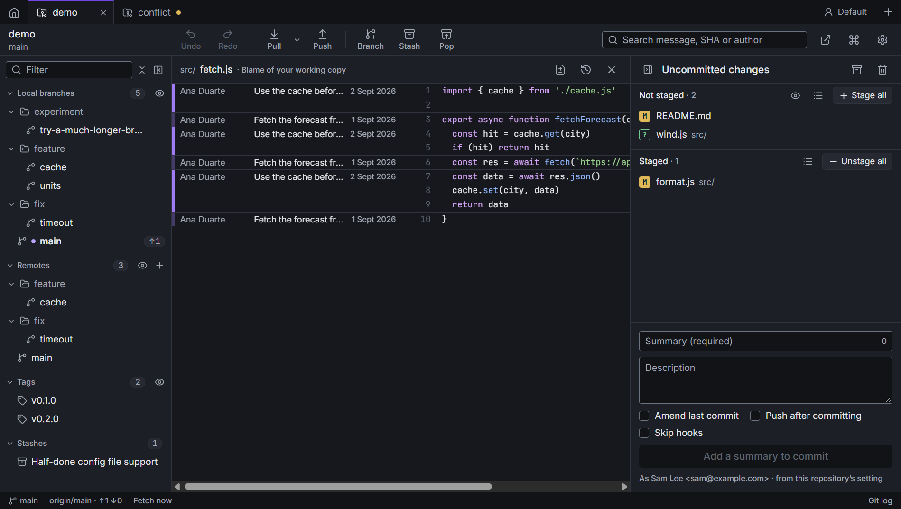

# File history and blame

## File history

Every commit that changed one file, newest first, with what changed in each.

Open it from:

- **File history** in a file's menu, in the changes list or in a commit's file list;
- the history icon in a diff's header, or **Ctrl+Shift+H** from a diff or blame;
- the command palette, while a file is open.

Click a commit to see its change to the file. Above the diff, choose **Changes** (only the changed blocks),
**File** (the whole file at that commit) or **Split** (side by side). **Commit details** shows the whole commit in the
details panel. Drag the edge of the commit list to resize it.

## Blame

Each line of the file, with the commit, author and date that last changed it. Lines you haven't committed yet say
**Not committed yet**. Click a line's commit to show it in the details panel. **Show changes**, in the header,
opens the file's diff.

Open it from:

- **Blame** in a file's menu, or the blame icon in a diff's header: the current version;
- **Blame at this commit** in a commit's file list, or from a diff of a commit: the file as it was then;
- the command palette, while a file is open.

**Blame the current version** goes back to today's file from an older one. Ctrl+Shift+H goes to the file's history.
