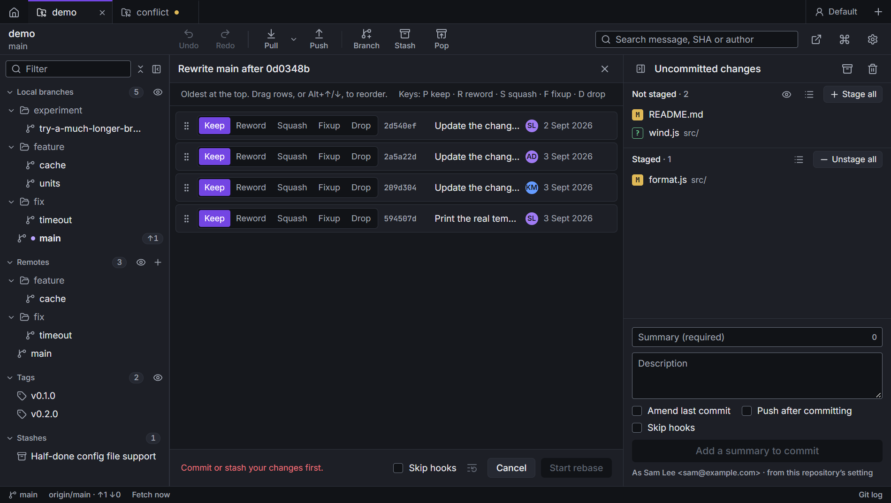
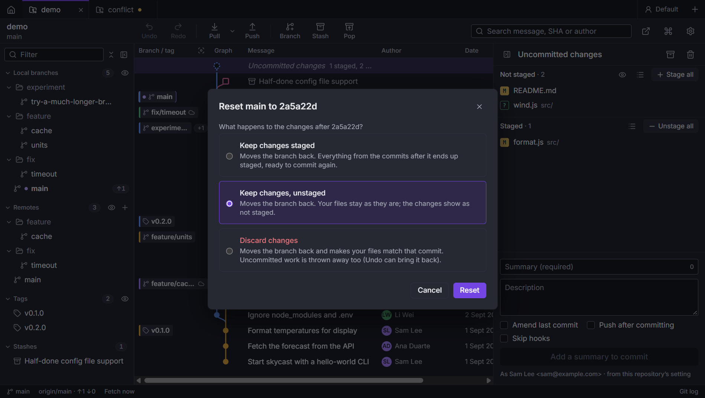

# Rewriting history

Everything on this page changes commits that already exist. Each one can be [undone](undo.md). If the commits are
already pushed, pushing again needs a [force push](syncing.md#when-a-push-is-rejected), and anyone who pulled them
has to deal with the change. Rewrite commits that are only yours when you can.

Git hooks run during a rewrite, as they would in a terminal, unless you tick **Skip hooks**.

Most of these need a clean working copy: commit or stash your changes first.

## Edit a commit's message

**Edit message…** in a commit's menu, or the pencil under the author in the details panel. The message becomes
editable in place; save to rewrite the commit and those after it. Merge commits, and commits with a merge after
them, can't be edited this way.

To change the last commit's message and content at once, use **Amend last commit** in the
[commit box](staging-and-committing.md#committing).

## Move a commit

**Move commit up** and **Move commit down** in a commit's menu swap it with its neighbour on the current branch.
Merge commits don't move.

## Squash

Pick several commits in a row on the current branch (Ctrl+click or Shift+click), then **Squash into one…**. The
new message starts with all of theirs, oldest first, for you to edit. The oldest commit's author and date are kept.

## Interactive rebase

Open it from:

- **Rewrite *branch* after this commit…** in a commit's menu: every commit after that one;
- **Rebase these…** with several commits picked: just those;
- **Interactive rebase *branch* onto *other*…** in a branch's menu, or **Rebase … step by step…** after dragging
  one branch onto another: the current branch's commits, moved onto the other branch.

Each commit gets one of:

| | | key |
| --- | --- | --- |
| Keep | keep it as it is | P |
| Reword | keep it, with a new message | R |
| Squash | fold into the commit above, keeping both messages | S |
| Fixup | fold into the commit above, dropping this message | F |
| Drop | leave it out | D |

The oldest commit is at the top. Drag rows, or use **Alt+↑ / Alt+↓**, to reorder them. **Start rebase** runs it;
if a step conflicts, Caboose stops and shows the [conflicts](conflicts.md).

## Cherry-pick

- **Cherry-pick onto *branch*** in a commit's menu copies that commit onto the current branch.
- With several commits picked, **Cherry-pick N commits onto *branch***.
- **Pick several commits up to here…** lists the commits of that branch that aren't on yours yet, so you can choose
  which ones to copy.

## Revert

**Revert this commit** adds a new commit that undoes it. The original stays in history, so this is safe on pushed
branches.

Reverting a merge commit asks first: it removes everything the merge brought in, and merging that branch again
later won't bring those changes back by itself.

## Reset

**Reset *branch* to this commit…** moves the current branch back to that commit. What happens to the changes after
it:

| | git |
| --- | --- |
| **Keep changes staged**: everything from the later commits ends up staged, ready to commit again | `--soft` |
| **Keep changes, unstaged**: your files stay as they are; the changes show as not staged | `--mixed` |
| **Discard changes**: your files match that commit; uncommitted work is thrown away too | `--hard` |

Undo can bring back even a hard reset.

From a remote branch's menu, **Reset to *origin/branch*** moves the local branch to match the remote one.
