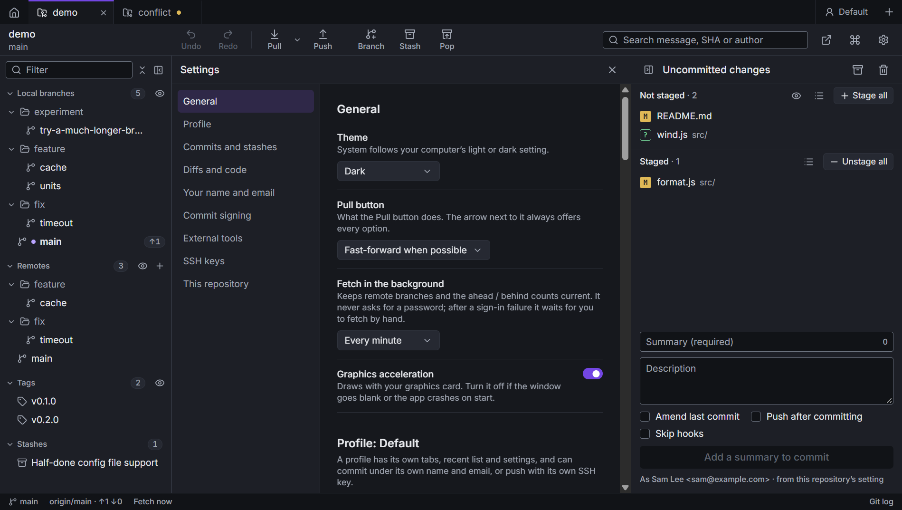

# Settings and profiles

Open Settings with the gear at the right of the toolbar, or **Settings** in the command palette. The sections are
listed on the left.

Some settings are Caboose's own. Others are git config values, and Caboose writes them where git would, so the
`git` command uses them too. Those are marked with their git name below.

## General

| | |
| --- | --- |
| Theme | Light, Dark or System (follows your computer) |
| Pull button | what **Pull** does: Fast-forward when possible, Fast-forward only, or Rebase. See [Syncing](syncing.md#pull) |
| Fetch in the background | Off, every minute, 5 minutes, 15 minutes or hour. Never asks for a password |
| Graphics acceleration | draws with your graphics card. Turn it off if the window goes blank or the app crashes on start. Takes effect after a restart |

If Caboose crashed with it on, it starts the next time without it and says so. You can turn it back on here.

## Profile

A profile has its own tabs, recent list and settings. It can commit under its own name and email, sign with its
own key, and fetch and push with its own SSH key, without touching your git config. Use one for work and one for
personal projects.

Switch profiles with the profile button at the right of the tab bar. **Manage profiles…** there (or in this
section) adds, renames and deletes them, and sets each one's:

| | |
| --- | --- |
| Commit as (name), Commit as (email) | empty uses git's `user.name` and `user.email` |
| Signing key | used when commit signing is on; empty uses git's `user.signingkey` |
| SSH key for fetch and push | one of the keys in your `.ssh` folder, or whatever your SSH config says |

## Commits and stashes

| | |
| --- | --- |
| Push after committing | ticks **Push after committing** under the commit message by default |
| Stash new files | include untracked files when you stash |
| Show untracked files | list files git isn't tracking yet among your changes (the eye on the list does the same) |

## Diffs and code

| | |
| --- | --- |
| Layout | Inline or Side by side. You can switch from any diff |
| Hide whitespace changes | leaves out lines where only spaces, tabs or line endings changed. Lines can't be staged from the diff while it's on |
| Wrap long lines | otherwise long lines scroll sideways |
| Code size | text size in diffs, blame and the merge tool |
| Tab width | how many spaces a tab takes up |

## Your name and email

Saved in git's global config (`user.name`, `user.email`) and written into every commit you make. A profile, or a
repository, can use another name and email without changing this.

## Commit signing

| | |
| --- | --- |
| Sign every commit | `commit.gpgsign` |
| Signing key | `user.signingkey`: the key ID or fingerprint (`gpg --list-secret-keys` shows it). Empty uses the key that matches your email |
| Commit message template | `commit.template`: a file whose text pre-fills the commit message |

Git does the signing with the `gpg` on your computer.

## External tools

| | |
| --- | --- |
| Terminal | the command that opens a terminal, for example `wt.exe -d {path}`. Empty uses the usual one for your system |
| Editor | the command that opens your editor, for example `code {file}` |
| Diff tool | `diff.tool`: the name git uses, like meld, kdiff3, bc or winmerge (`git difftool --tool-help` lists them) |
| Merge tool | `merge.tool`: used by **Open in merge tool** on a conflicted file |

Commands run without a shell. `{path}` is the repository folder, `{file}` the file you picked (or the folder). **Try it on
this repository** checks a command.

## SSH keys

Lists the public keys in your `.ssh` folder, with a button to copy each one. Add a public key to your git host
(GitHub, GitLab…) to push and pull over SSH.

To make a new key, give it a file name, a label (like `laptop`) and an optional passphrase. Caboose runs
`ssh-keygen` and creates an ed25519 key in `~/.ssh`.

## This repository

Settings for the repository in the current tab only:

- **Name** and **Email**: override your global ones here, for example a work address. Leave both empty to use the
  global ones.
- **Sign commits here**: use the global setting, or turn signing on or off for this repository.
- **Signing key**: empty uses your global key.

## Submodules

Shown when the repository has submodules. See [Submodules](submodules.md#other-settings).

## Where settings are kept

Caboose's own settings, profiles and the repository list are in your user data folder (for example
`%APPDATA%\Caboose` on Windows). They survive reinstalls. Git config values are in git's own files.
