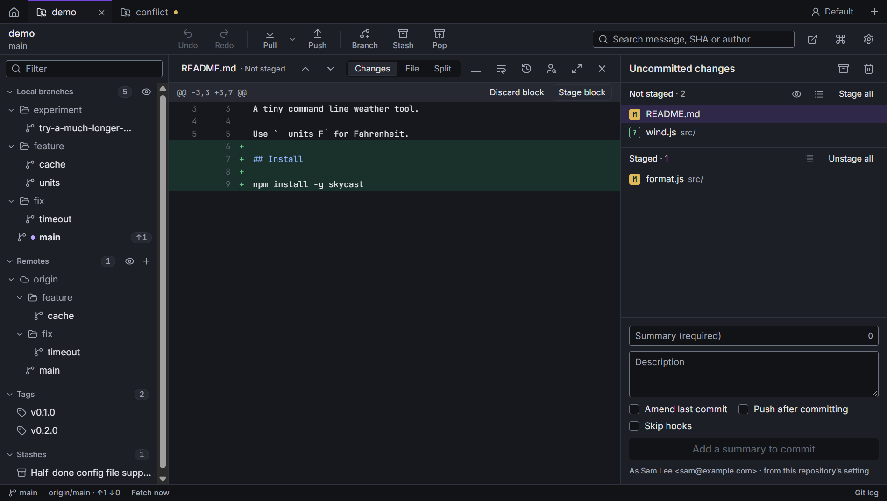

# Staging and committing

Click **Uncommitted changes** at the top of the graph. The details panel shows two lists, **Not staged** and
**Staged**, with the commit box under them.

## The file lists

- The list icon on each header switches between a flat list and a **folder tree**. In the tree, right-click
  for **Collapse all** or **Expand all**.
- The eye on **Not staged** shows or hides untracked files (files git isn't tracking yet).
- **Stage all** (Ctrl+Shift+S) and **Unstage all** (Ctrl+Shift+U) are on the headers.
- Click a file to open its diff. Ctrl+click or Shift+click to pick several, then stage, unstage or discard them
  together.

Each file has a letter: **M** modified, **A** added, **D** deleted, **R** renamed, **C** copied, **U**
conflicted and **?** untracked. Files stored in [Git LFS](lfs.md) get an LFS badge.

### File menu

Right-click a file (or several):

| | |
| --- | --- |
| Stage / Unstage | |
| Discard changes… | asks first, and can be [undone](undo.md) |
| Ignore | the file only, all files with its extension, or its folder; also undoable. **On this computer only** does the same for new files without changing `.gitignore` |
| Track with Git LFS / Stop tracking | see [Git LFS](lfs.md) |
| Open in editor, Open in diff tool, Show in folder | your own tools, see [Settings](settings.md#external-tools) |
| Open in merge tool | for a conflicted file |
| File history, Blame | see [File history and blame](history-and-blame.md) |
| Copy path | |

### Ignoring files on this computer only

**Ignore** adds lines to the repository's `.gitignore`, which you commit, so everyone ignores those files. For files
that only matter to you, like your own notes or an editor's settings, use **Ignore › On this computer only**
instead: the same choices (the file, its extension, a folder) go to `.git/info/exclude`, which git reads like
`.gitignore` but never commits. Undo takes them out again.

It's offered for new files only. Git keeps tracking a file it already has, whatever the ignore rules say, and
stopping that would be a change everyone gets.

## Diffs

The header of a diff has:

- **Previous / next change**, to jump between blocks;
- **Find in file** (Ctrl+F): type to highlight every match, **Enter** for the next one, **Shift+Enter** for the
  previous one, **Esc** to close;
- **Diff layout**: inline or side by side;
- **Hide whitespace changes**;
- **Diff options**: **Wrap long lines**, and **Lines around changes**, how many unchanged lines show above and
  below each change, from 1 to 25 (3 by default). With more, changes close together join into one block. The
  whole-file layout shows every line, so it has none to set;
- **File history**, **Use the full width** and **Close** (Esc).

Your choices are remembered. The default layout, code size and tab width are in [Settings](settings.md#diffs-and-code).

Some files get a different view:

- **Binary files** say only that they changed.
- **Git LFS files** say how the stored file changed, not the pointer text.
- **Submodules** list the commits the pointer moves by. See [Submodules](submodules.md).
- **Large changes** wait for **Show anyway** before drawing thousands of lines.
- **Only whitespace changed** says so when whitespace is hidden.

## Staging blocks and lines

In a diff of a file that isn't staged, each block of changes has **Stage block** and **Discard block** buttons. In
a staged file, it has **Unstage block**.

To stage only some lines, click their line numbers to pick them (Shift+click picks a range), then use the block's
button, which now reads **Stage 2 lines** (for example): it acts on the picked lines only. **Clear** drops the pick.

With the keyboard: focus a block, then **↑ / ↓** move between changed lines, **Shift+↑ / ↓** picks as it moves,
**Space** picks or unpicks a line, and **Enter** stages (or unstages) the pick, or the whole block when nothing is
picked.

Lines can't be picked while whitespace changes are hidden, because the patch git applies has to match the file.
The blocks you stage are always the ones on screen, however many lines around changes you show.

When the open file is fully staged, the diff follows it to the Staged list, and back again when you unstage it.

## Committing

- **Summary** is required. The counter shows its length. **Description** is optional.
- **Ctrl+Enter** commits what's staged. **Ctrl+Shift+Enter** stages everything and commits.
- **Ctrl+Shift+M** jumps to the summary from anywhere.
- **Amend last commit** replaces the last commit with one that includes what's staged, and fills in its message
  for you to edit.
- **Push after committing** pushes as soon as the commit is made. Its default is a setting.
- **Skip hooks** runs `git commit --no-verify`.

The line under the button says who the commit will be from (name and email), and where that comes from when it
isn't your global git config: this repository's setting or your profile.

In a [submodule](submodules.md) that isn't on a branch, Caboose asks before committing and offers to create a
branch, because those commits are easy to lose.

A commit message template (`commit.template`) pre-fills the message. Commit signing is set in
[Settings](settings.md#commit-signing).

When a commit leaves nothing else to commit, you're taken back to the commit list.

## Discarding everything

The trash icon on **Uncommitted changes** (or **Discard all changes…** in the command palette) throws away every
change. Caboose keeps a copy first, so **Undo** brings it all back.

## Cleaning up the working tree

The eraser icon on **Uncommitted changes** opens **Clean up the working tree**. Tick what goes:

- **Changes to tracked files**: the folder goes back to the last commit, staged changes included (`git reset
  --hard`).
- **Untracked files**: new files that were never committed (`git clean`).
- **Ignored files**: what `.gitignore` leaves out, like build output and dependencies.

It lists what will be removed, and **Undo** brings it all back, staged changes staged again. Ignored files are copied
for undo too, which takes a while for a big folder like `node_modules`.

**Remove untracked files…** (in the command palette, or the menu of the **Uncommitted changes** row in the graph)
opens it with only the untracked files ticked. With conflicts, resolve them or abort first.
